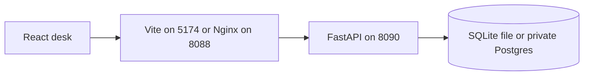
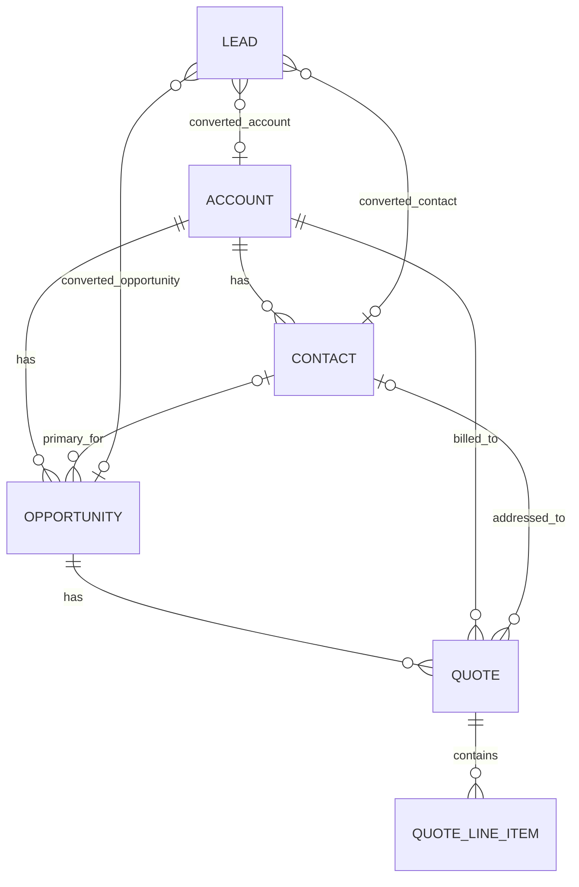
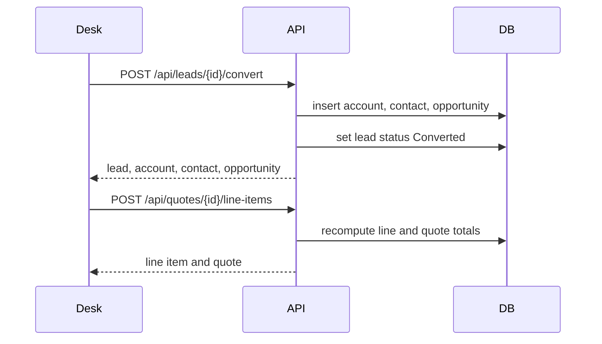

# Harbor CRM

A custom sales desk for six objects: Lead, Account, Contact, Opportunity, Quote, and QuoteLineItem.

The React desk talks to a FastAPI service. FastAPI stores records in SQLite when you run it on your machine, or in Postgres when you run Docker Compose. Quote totals are calculated on the server. Converting a lead creates an account, a contact, and an optional opportunity, then locks the lead.

## Architecture





Lead conversion is one way. A quote always takes its account from the opportunity. Line totals, header discount, tax, and grand total are server-owned. Marking a quote Accepted copies the grand total onto the opportunity amount.



Pricing, rounded half up to cents at each step:

- line total = quantity × unit price × (1 − line discount %)
- subtotal = sum of line totals
- discount = subtotal × header discount %
- tax = (subtotal − discount) × tax %
- grand total = subtotal − discount + tax

## Local run

From `crm/backend`:

```bash
python3 -m venv .venv
source .venv/bin/activate
pip install -r requirements.txt
python seed.py
uvicorn app.main:app --host 127.0.0.1 --port 8090
```

From `crm/frontend`:

```bash
npm install
npm run dev
```

Open http://127.0.0.1:5174. The sample desk includes Northwind Goods and Lumen Field Clinics.

API docs: http://127.0.0.1:8090/docs

The SQLite file is created at `crm/data/crm.sqlite`. No password is stored in source.

## Docker

Postgres is only on the Compose network. The web container is bound to `127.0.0.1:8088` and proxies `/api` to the API. Set `POSTGRES_PASSWORD` in `crm/.env` to a private value made of letters and numbers. Leave `CRM_API_TOKEN` empty for the local desk. If you set it, the desk asks for the token and keeps it in memory for that tab.

```bash
cd crm
cp .env.example .env
# edit POSTGRES_PASSWORD
docker compose up --build
```

Open http://127.0.0.1:8088.

`database/schema.sql` is the Postgres reference. The API also creates the tables on startup.

## API

| Method | Path | Purpose |
| --- | --- | --- |
| GET | `/api/health` | Process status. Does not require a token. |
| GET | `/api/dashboard` | Counts, pipeline, recent leads |
| GET POST | `/api/leads` | List and create leads |
| GET PATCH DELETE | `/api/leads/{id}` | Read, update, delete |
| POST | `/api/leads/{id}/convert` | Create account, contact, and optional opportunity |
| GET POST | `/api/accounts` | List and create accounts |
| GET PATCH DELETE | `/api/accounts/{id}` | Read, update, delete |
| GET POST | `/api/contacts` | List and create contacts |
| GET PATCH DELETE | `/api/contacts/{id}` | Read, update, delete |
| GET POST | `/api/opportunities` | List and create opportunities |
| GET PATCH DELETE | `/api/opportunities/{id}` | Read, update, delete |
| GET POST | `/api/quotes` | List and create quotes |
| GET PATCH DELETE | `/api/quotes/{id}` | Read, update, delete |
| GET POST | `/api/quotes/{id}/line-items` | List and add quote line items |
| PATCH DELETE | `/api/quotes/{id}/line-items/{line_id}` | Update or remove a line |

List routes accept `q`, `limit`, and `offset`. Leads filter by `status`. Opportunities filter by `account_id`, `primary_contact_id`, and `stage`. Quotes filter by `opportunity_id`, `account_id`, `contact_id`, and `status`.

Tests: `cd crm/backend && .venv/bin/pytest`

## Production notes

Put Harbor behind a TLS 1.3 proxy before anyone but you can reach it. Set `CRM_API_TOKEN` from a secret store. Keep Postgres private and give the API its own database user. This version has no user accounts; the optional bearer token is a single shared secret, compared with `secrets.compare_digest`, and is never written to the database or the browser's storage.
