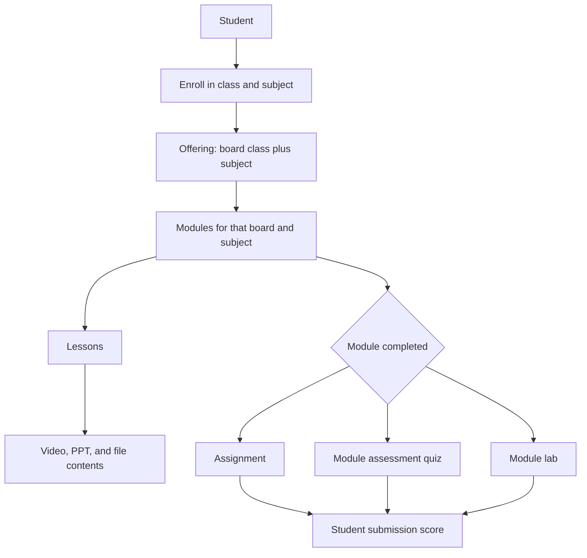
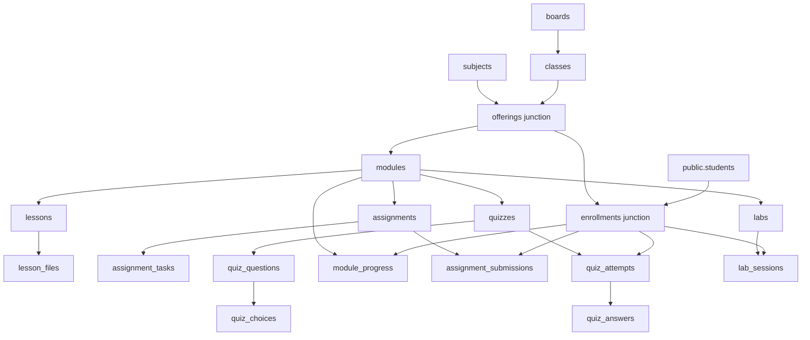
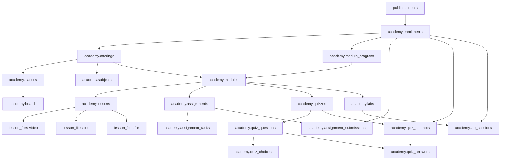

# Academy portal tables

Student rows stay in `public.students`. Curriculum, enrollment, and results live in the `academy` schema on the same Postgres database. Video, PPT, and other lesson files are stored as `lake://` URIs. The database password stays in the environment (`POSTGRES_HOST`, `POSTGRES_PORT`, `POSTGRES_DB`, `POSTGRES_USER`, `POSTGRES_PASSWORD`). No certificate is stored.

Boards are CBSE, ICSE, and WBBSE (West Bengal Board of Secondary Education). Each board has classes 7 through 12. Subjects are AI & Computer Science, Science, and Mathematics. A module belongs to one class and one subject, so each board keeps its own modules.

## Flow

A student enrolls in a class and a subject. That offering lists the modules for that board. Each module has its own lessons, and each lesson stores a video, a PPT, and a file as `lake://` URIs. When `module_progress.status` becomes `completed`, a database trigger inserts the assignment submission for that student. The module quiz and the module lab are the assessment and the lab for that module. Scores are stored on the submission, the quiz attempt, and the lab session.

## Table relations

## Parent-child

- `boards` → `classes`. Unique `(board_id, grade)` for grades 7–12.
- `offerings` → `modules` → `lessons` → `lesson_files`. `lesson_files.kind` is `video`, `ppt`, or `file`. A lesson can hold more than one of each. `storage_uri` must start with `lake://`.
- `modules` → `assignments`. One assignment per module. It is issued when that student's module progress becomes `completed`.
- `assignments` → `assignment_tasks`.
- `modules` → `quizzes`. One assessment per module. `quizzes` → `quiz_questions` → `quiz_choices`.
- `modules` → `labs`. One lab per module. `tool_key` is `python`, `data`, `generative`, `office`, `computer`, or `java`.
- `enrollments` → `module_progress`, `assignment_submissions`, `quiz_attempts`, and `lab_sessions`.

`module_progress` is unique on `(enrollment_id, module_id)`. Status moves `locked` → `in_progress` → `completed`. The module must belong to the offering on that enrollment.

## Junction tables

- `offerings` joins `classes` and `subjects`. Unique `(class_id, subject_id)`. The board comes from `classes.board_id`, so CBSE Class 7 Science and WBBSE Class 7 Science do not share modules. This row is also the parent of `modules`.
- `enrollments` joins `public.students` and `offerings`. Unique `(student_id, offering_id)`. Status is `enrolled`, `completed`, or `withdrawn`. A student in Class 9 can enroll in AI & Computer Science, Science, and Mathematics as three rows.

The foreign key from `enrollments.student_id` to `public.students` is added when that table exists. Child rows use `ON DELETE CASCADE` from the parent. Quiz answers keep the written answer if a choice row is removed (`ON DELETE SET NULL` on `choice_id`).

## Example: class, board, and AI & Computer Science

The Class 7 CBSE module list stays in place. This example adds two sample students in each of three offerings. Every student enrolls only in AI & Computer Science. The class and the board differ, so the modules differ too.

- CBSE Class 10: Meera Iyer (`STU-ACADEMY-CBSE-10-01`) and Arun Bose (`STU-ACADEMY-CBSE-10-02`). Modules: Python for data, AI project cycle.
- ICSE Class 9: Neel Roy (`STU-ACADEMY-ICSE-9-01`) and Sara Ghosh (`STU-ACADEMY-ICSE-9-02`). Modules: Logic and Java, Learning from examples.
- West Bengal (WBBSE) Class 8: Ani Das (`STU-ACADEMY-WBBSE-8-01`) and Ruhi Sen (`STU-ACADEMY-WBBSE-8-02`). Modules: Computers in daily life, Data and patterns.

Each module has two lessons. Each lesson has one video, one PPT, and one file. Both students have finished the first module, so each has a submitted assignment, a quiz attempt with two answers, and a completed lab session. The second module is `in_progress`, so its assignment is not issued yet.

No sample student has a password. Login hashes already stored on other student rows are left as they are.

## How a page picks the related tables

Start from the student. The enrollment is the only bridge into a class and a subject. The offering then selects the board, the class, and the subject, and every later row hangs off that offering or that enrollment.

For Meera Iyer the walk is: student → enrollment → CBSE Class 10 AI & Computer Science offering → that offering's two modules → each module's two lessons → the video, PPT, and file on each lesson. Her completed module also reaches the assignment submission, the quiz attempt, and the lab session. Arun Bose uses the same modules, because he shares the offering, and his own enrollment for the scores. An ICSE Class 9 student never sees those CBSE modules, because the offering id is different.
